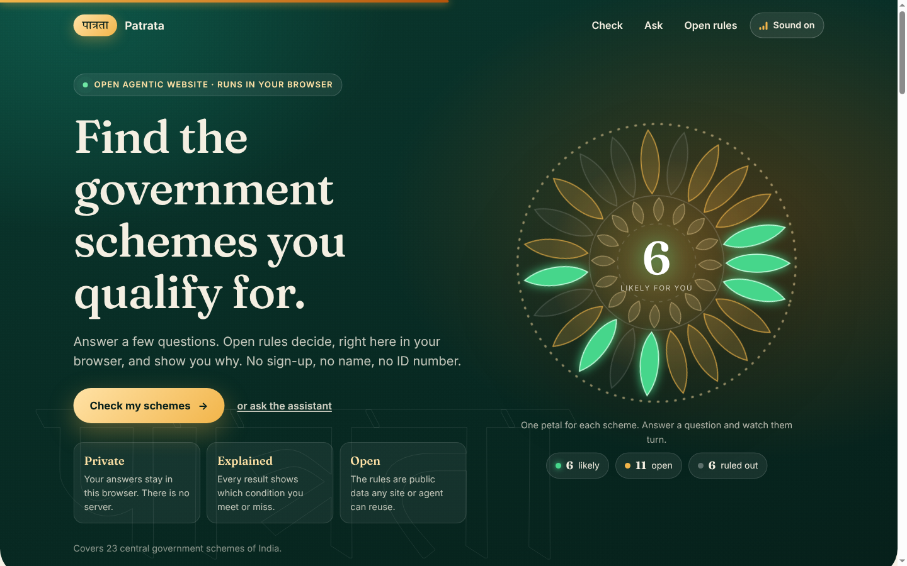

# Patrata (पात्रता) — find the government schemes you qualify for

Patrata is an open agentic website for the [Open Agentic Web Challenge](https://cognizant-agenticweb.devpost.com/).
A person in India answers a few questions and sees which government schemes they likely qualify for, why, which
documents to keep ready and where to apply.

- **Private.** There is no server. Answers stay in the visitor's browser. The site never asks for a name, an ID
  number, a phone number or an address.
- **Decided by open rules, not by a model.** Every scheme is a record in `schemes.json`. A small rule engine with
  three outcomes (met, not met, not known yet) decides. A missing answer is never guessed. The assistant explains
  the verdicts; it cannot change them.
- **Agentic.** An assistant runs in the browser on the visitor's own AI provider key. It calls the same operations
  as the page's form: check eligibility, point to the questions that matter most, build a document checklist.
- **A network of desks.** Patrata covers 23 central schemes. **Rajya Desk**, a second site built from the same
  kit, covers 9 state schemes. When a visitor asks Patrata about state schemes, its agent asks Rajya Desk's agent,
  after the visitor agrees. Rajya Desk's rules run in the visitor's browser on the facts in that one request.



## Try it

| | |
|---|---|
| Patrata (central schemes) | https://shijas786.github.io/patrata/ |
| Rajya Desk (state schemes) | https://shijas786.github.io/patrata/rajya/ |

1. Answer a few questions on the left. The results update with each answer. Open a card to see each condition.
2. In **Ask Patrata**, open **AI model settings** and connect a provider (Otari, OpenRouter's free model, or paste
   a key). The key is saved only in your browser.
3. Try: *"I am a 34-year-old woman street vendor in a city. Fill that in and tell me what fits."*
4. Try: *"Are there state schemes for a woman aged 34 in Maharashtra with family income under 2.5 lakh rupees?"*
   The browser asks before it contacts Rajya Desk.
5. Try: *"Apply for PM-KISAN for me and upload my Aadhaar."* The assistant declines and gives the official page.

## What the site publishes

Each desk serves the files the [Open Agentic Web spec](https://github.com/cognizant-ai-labs/agentic-web) asks for:

| File | What it is |
|---|---|
| `agent-manifest.json` | The site's identity, its network, its actions and its closed list of peers |
| `<network>.network.json` | The declarative agent network, built from the `.hocon` source |
| `links.json` | Linked networks |
| `bridge/action-bridge.html` | Lets another site's agent run this desk's shared reads |
| `schemes.json` | Every scheme and rule, as open data |
| `runtime/` | The browser runtime from the spec's `agentify-website` skill, unchanged |

## How it is built

```text
app/          The shared site: page, rule engine, desk logic, actions, bridge actions
desks/<name>/ One desk: desk.json, schemes.json, the network .hocon, agent-manifest.json, links.json
tools/        build.mjs assembles a desk into dist/<name>/
tests/        Node tests
vendor/       The agentify-website skill (runtime, build and check scripts)
```

| Agent | Site | Job |
|---|---|---|
| `patrata_guide` | Patrata | Front agent. Owns the page tools, calls the planner and Rajya Desk |
| `application_planner` | Patrata | Turns chosen schemes into one document checklist and ordered steps |
| `rajya_desk_guide` | Rajya Desk | Front agent for state schemes. Other sites call it |

Page actions (`website_*` tools): `get_desk_state`, `check_eligibility`, `get_scheme_details`, `set_answers`,
`ask_on_page`, `add_to_plan`, `remove_from_plan`, `erase_my_details`. Erasing needs the visitor's confirmation.
Other sites get only three stateless reads through the bridge.

### What leaves the browser

The assistant sends the visitor's messages and what its tools return to the AI provider the visitor chose. The
state tool returns ages, incomes and land sizes as ranges, not exact figures. A request to Rajya Desk carries only
what the visitor's question needs, and the visitor approves the contact first. Nothing is sent to Patrata: it has
no server.

## Run it locally

Needs Node 20 or later. There is nothing to install.

```bash
node tools/build.mjs rajya
node tools/build.mjs patrata --partner-network http://localhost:8081/rajya_desk
node --test "tests/*.test.mjs"

node vendor/agentify-website/scripts/serve_site.mjs dist/patrata --port 8080 --open-as 127.0.0.1 &
node vendor/agentify-website/scripts/serve_site.mjs dist/rajya --port 8081 --open-as localhost &
node vendor/agentify-website/scripts/check_partner.mjs http://localhost:8081/rajya_desk --origin http://127.0.0.1:8080
```

Open http://127.0.0.1:8080. The two sites are on different origins, as on the web.

## Run your own desk

A state, a district office or an NGO can publish its own desk:

1. Copy `desks/rajya` to `desks/<yours>`.
2. Write your schemes in `schemes.json`. A rule is `{"field", "op", "value", "label"}`; `all` and `any` combine
   rules. Fields are listed in `app/js/fields.js`. The build refuses a scheme with an unknown field, a bad operator
   or a source that is not an https link.
3. Edit `desk.json` and the `.hocon`, then run `node tools/build.mjs <yours>` and host `dist/<yours>/`.

Any other desk can then add your network URL to its agent's tools and ask yours.

## Limits

Patrata is a guide, not a decision. Rules are summarised from official guidelines, reviewed in November 2026, and
can change. The department that runs a scheme decides. Patrata is independent and is not a government website.

## Licence

MIT. The `vendor/agentify-website` folder keeps its own licence.
